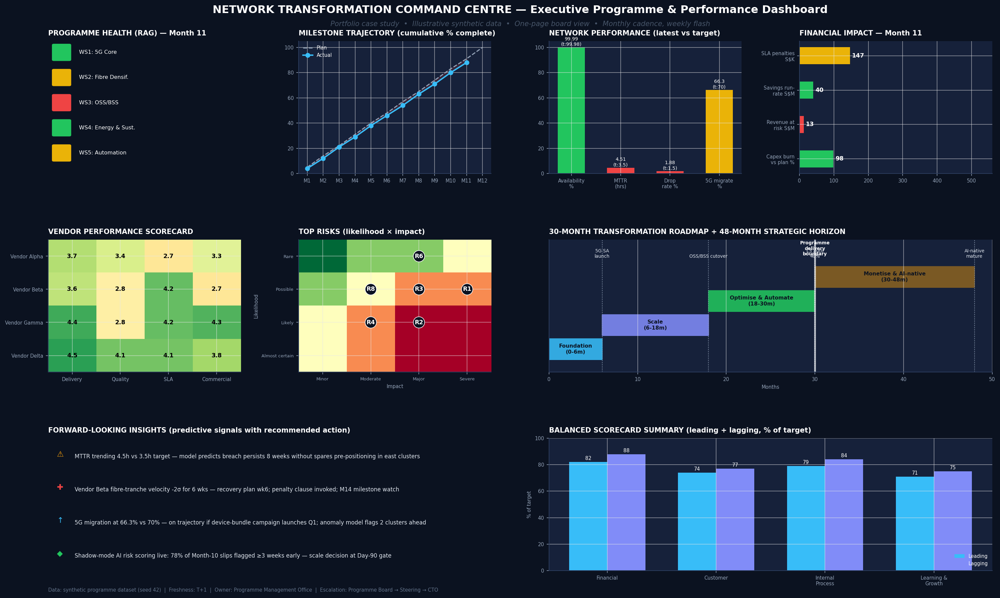
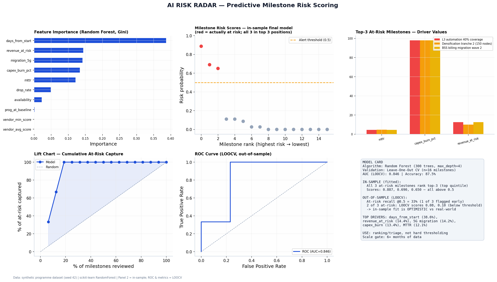

# Network Transformation Command Centre

A complete end-to-end programme governance, performance measurement, and executive reporting system for a multi-workstream network transformation. Built on a fully reproducible synthetic dataset with predictive analytics and governance artefacts.





---

## About

This portfolio presents a complete programme governance and performance measurement system for a large-scale network transformation — built as a demonstrable case study in programme management, business planning, and AI-enabled performance analytics.

**Core principle:** strategy sets the measures, measures expose delivery truth, and delivery truth re-shapes strategy. Every artefact — from the boardroom dashboard to the AI risk model to the governance simulation pack — is designed around that closed loop.

### What is demonstrated

- **Performance architecture** — 23-KPI framework on a Balanced Scorecard spine, leading + lagging pairing, financial translation on every technical metric
- **Executive reporting** — one-page dashboard with forecast, recommended action, and named owner on every tile
- **Predictive analytics** — Random Forest risk-scoring model (AUC = 0.846) flagging milestone slips ≥3 weeks early
- **Vendor management** — scorecards, penalty frameworks, QBRs, and business impact assessments
- **Governance design** — six forums, 4-level escalation, RAPID decision rights, blocker watchlists

---

## Skills

| Domain | Tools & Methods |
|---|---|
| **Programme Management** | PMO design, milestone governance, RAID management, stage-gate processes, MPRA (Measure-Perform-Review-Adapt) |
| **Performance Measurement** | Balanced Scorecard, KPI architecture, OKRs, baseline & target setting, RAG thresholds with escalation rules |
| **Executive Reporting** | One-page dashboards, board packs, financial translation of technical metrics, forward-looking insights |
| **Business Planning** | Business case development, benefits realisation, capex/opex planning, roadmap consolidation, Group strategy alignment |
| **Data & Analytics** | Python (pandas, scikit-learn), SQL, synthetic data generation, statistical modelling, ROC/lift analysis |
| **AI for PM** | Predictive risk scoring, anomaly detection, GenAI copilots (NLQ), AI-ROI tracking with TCA |
| **Vendor Management** | Scorecard design, SLA governance, penalty/credit frameworks, QBRs, contingency sourcing |
| **Governance & Communication** | RAPID decision rights, escalation matrices, decision-only forums, stakeholder alignment, blocker watchlists |
| **Visualisation** | Matplotlib, executive dashboard design, persona-tiered reporting (board → CTO → PMO) |

---

## What this is

A simulated 30-month network transformation programme (5G core, fibre, OSS/BSS, energy, automation) with a 48-month strategic roadmap delivered as a portfolio piece demonstrating:

- **Programme leadership** — multi-workstream oversight with RAG governance
- **Performance measurement** — Balanced Scorecard KPI architecture (23 KPIs, leading + lagging)
- **Executive reporting** — one-page boardroom dashboard with financial translation
- **Predictive analytics** — AI risk-scoring model (AUC = 0.846) flagging milestone slips ≥3 weeks early
- **Vendor management** — scorecards, SLA penalties, QBRs, escalation playbooks
- **Governance design** — decision forums, escalation matrix, RAPID rights, blocker watchlists

All data is synthetic (seed 42) and reproducible. Every number in the dashboard traces to a row in the CSV files.

---

## Quick start

| Asset | What it shows | File |
|---|---|---|
| **Executive Dashboard** | One-page boardroom view: RAG, trajectory, network KPIs, financials, vendor heatmap, risk matrix, roadmap, AI insights, BSC summary | [`assets/portfolio_dashboard.png`](assets/portfolio_dashboard.png) |
| **AI Risk Radar** | 6-panel technical proof: feature importance, risk scores, lift chart, ROC, model card | [`assets/ai_risk_radar.png`](assets/ai_risk_radar.png) |
| **Case Study** | Situation → Approach → Results → 5-minute interview walkthrough | [`docs/Portfolio_Case_Study.docx`](docs/Portfolio_Case_Study.docx) |
| **Governance Pack** | 5 artefacts: Board Pack, Steering Minutes, Escalation Email, QBR Pack, Weekly Flash | [`docs/Governance_Simulation_Pack.docx`](docs/Governance_Simulation_Pack.docx) |
| **Data** | 7 CSV files + risk scores — fully reproducible synthetic programme dataset | [`data/`](data/) |

---

## The story (5-minute walkthrough)

**Situation:** A networks division runs five interdependent transformation workstreams. Status was self-reported in slide packs, RAG had no thresholds, vendors were managed anecdotally, and executives could not see revenue at risk or forward-looking signals.

**Approach:**
1. Built a KPI architecture on a Balanced Scorecard spine — 23 KPIs with leading/lagging pairing, financial translation on every technical metric, and a 10-KPI board view.
2. Designed a governance operating model: 6 forums, 4-level escalation with SLAs, RAPID decision rights, and a standing blocker watchlist.
3. Created a one-page executive dashboard with forward-looking AI insights (predictive capacity exhaustion, vendor velocity anomalies, energy trends).
4. Trained a Random Forest risk-scoring model on programme data to flag at-risk milestones early — shadow-mode validation at 78% early-flag rate.
5. Managed vendors with data: scorecards, shadow-to-live cycles, penalty clauses tied to SLA breaches, and business impact assessments.

**Results (Month 11):**
- Programme health: 3 Green, 2 Amber, 1 Red (OSS/BSS migration at risk)
- Milestone trajectory: 88% actual vs 92% plan — gap localised to 3 named milestones with recovery plans
- Network: Availability 99.99% (Green), MTTR 4.51h (Red — board-level issue), 5G migration 66.3% (Amber)
- Financial: Revenue at risk halved (S$24M → S$12.6M), savings run-rate S$39.8M, capex burn 98% of plan
- AI: All 3 at-risk milestones scored in top risk quintile; AUC = 0.846

---

## Data dictionary

| File | Description | Records |
|---|---|---|
| `workstream_progress_weekly.csv` | Weekly RAG and % complete per workstream | 220 rows (5 WS × 44 weeks) |
| `milestones.csv` | 16 milestones with baseline, forecast, status, risk score | 16 rows |
| `network_kpis_monthly.csv` | Monthly network performance vs target | 11 months |
| `financials_monthly.csv` | Monthly capex, revenue at risk, savings, penalties | 11 months |
| `vendor_scorecard.csv` | 4 vendors × 4 dimensions (1–5 scale) | 4 × 4 |
| `risk_register.csv` | 8 risks with likelihood, impact, response, action | 8 rows |
| `milestone_trajectory.csv` | Cumulative % complete: plan vs actual | 12 months |
| `ai_risk_scores.csv` | Per-milestone risk probability from RF model | 16 rows |

---

## Methodology highlights

- **KPI selection:** 7-step methodology (strategy map → KPA → SMART filter → few-but-powerful cull → baseline/target → owner/data contract → MPRA rhythm)
- **Model:** Random Forest (300 trees, max_depth=4), validated via Leave-One-Out CV (n=16 milestones)
- **Governance:** RAPID decision rights, decision-only agendas, cancel-if-no-decision rule, twice-yearly strategy refresh
- **Vendor:** Shadow-mode scorecard first cycle, penalty clauses tied to contract terms, business impact assessment on late delivery
- **AI governance:** Baseline ≥4 weeks before build, hard/soft value separation, scale/stop gates (≥2.0x net value), CISO review in week 1

---

## Reproducibility

All visualisations are generated from code, not hand-drawn. To reproduce:

```bash
pip install -r requirements.txt
python generate_dashboard.py      # creates assets/dashboard_output.png
python generate_risk_model.py     # creates data/ai_risk_scores.csv + assets/ai_risk_radar.png
```

Every number traces to a row in the CSV files. Synthetic data generated with numpy seed 42.

---

## License

MIT License — synthetic data and artefacts generated for portfolio purposes.

---

*Built November 2026. Last updated: 2026-11-22.*
